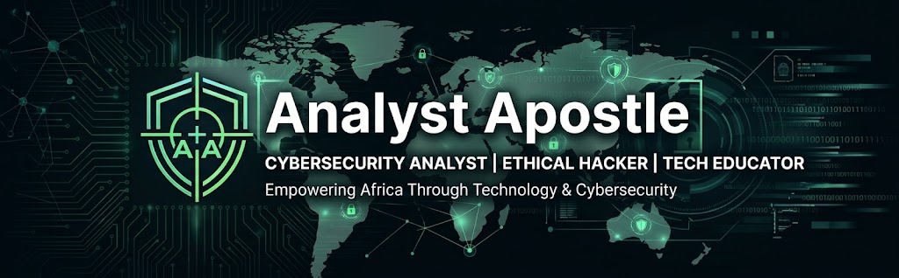

# Fred Chinonso Timothy | Cybersecurity Analyst & Technology Educator

<!-- ============================================ -->
<!-- 1. PROFILE BANNER -->
<!-- ============================================ -->

  

<!-- ============================================ -->
<!-- 2. ANIMATED PROFESSIONAL TYPING SVG -->
<!-- ============================================ -->

  

---

<!-- ============================================ -->
<!-- 3. INTRODUCTION -->
<!-- ============================================ -->

## Introduction

I am **Fred Chinonso Timothy**, a cybersecurity enthusiast and developing professional focused on **Cybersecurity Analysis, Ethical Hacking, Technology Education, and Mentorship**.

I am passionate about understanding how technology works, identifying security weaknesses, protecting digital environments, and making technical education accessible to more people.

My interests span cybersecurity, artificial intelligence, Linux, digital transformation, technology advocacy, and community development.

I believe practical knowledge, continuous learning, and collaboration can help create a safer and more digitally empowered Africa.

<!-- ============================================ -->
<!-- 4. ABOUT ME -->
<!-- ============================================ -->

## About Me

- Building my professional career in cybersecurity through continuous learning and practical experience.
- Developing hands-on skills in ethical hacking, penetration testing, and security analysis.
- Exploring cybersecurity tools, Linux environments, and controlled security laboratories.
- Interested in network security, web application security, and vulnerability assessment.
- Teaching and mentoring beginners interested in technology and cybersecurity.
- Passionate about helping young Africans develop relevant digital and technical skills.
- Exploring the intersection of artificial intelligence, cybersecurity, and technology education.
- Interested in public speaking, community building, and digital empowerment.

<!-- ============================================ -->
<!-- 5. CYBERSECURITY -->
<!-- ============================================ -->

## 🛡️ Cybersecurity

My cybersecurity interests and developing technical competencies include:

- Ethical Hacking
- Penetration Testing
- Vulnerability Assessment
- Network Security
- Web Application Security
- Security Analysis
- Security Operations
- Security Awareness
- Linux Security
- Network Reconnaissance
- Threat Analysis
- Incident Detection and Response

*These represent areas of professional interest and ongoing development, not a claim of mastery or certification.*

<!-- ============================================ -->
<!-- 6. TOOLS & TECHNOLOGIES -->
<!-- ============================================ -->

## Tools & Technologies

Technologies and tools I use or am exploring throughout my cybersecurity and development journey.

  

**Cybersecurity Toolkit**

  
  
  
  
  
  

<!-- ============================================ -->
<!-- 7. CURRENTLY LEARNING -->
<!-- ============================================ -->

## Currently Learning

I believe professional growth comes from consistent learning, practical application, and continuous improvement.

My current technical development roadmap includes:

- Advanced Ethical Hacking
- Penetration Testing Methodologies
- Web Application Security
- Network Security
- Vulnerability Assessment
- Python for Cybersecurity
- Linux Administration and Security
- Artificial Intelligence
- Security Automation
- Security Operations and Threat Analysis

<!-- ============================================ -->
<!-- 8. HANDS-ON CYBERSECURITY -->
<!-- ============================================ -->

## Hands-On Cybersecurity

I believe cybersecurity knowledge becomes meaningful when supported by practical experience.

I work with controlled learning environments and authorized security-testing laboratories involving:

- **Kali Linux:** Security tools and penetration-testing environments.
- **Metasploitable 2:** Deliberately vulnerable systems for practical security exercises.
- **Network Reconnaissance:** Understanding network structures, hosts, and exposed services.
- **Vulnerability Discovery:** Identifying and understanding security weaknesses.
- **Web Application Security Testing:** Exploring common web vulnerabilities.
- **Authorized Exploitation:** Understanding exploitation techniques in controlled environments.
- **Security Analysis:** Examining findings and understanding potential security implications.
- **Linux Administration:** Working with users, permissions, services, and system configurations.

All practical security testing is conducted for ethical, educational, and authorized purposes.

<!-- ============================================ -->
<!-- 9. FEATURED PROJECTS -->
<!-- ============================================ -->

## 🚀 Featured Projects

I am continuously developing my technical portfolio through hands-on laboratories, research, and practical projects.

The following are project categories for which I intend to publish documented work as my portfolio grows.

| Project | Description | Repository |
|---|---|---|
| 🔐 Cybersecurity Labs | Practical cybersecurity exercises and laboratory documentation. | [https://github.com/fredchinonso555-ui/Suricata-IDS-Lab](#featured-projects) |
| 🐍 Python Security Projects | Python scripts and automation for cybersecurity learning. | [Add Repository Link](#featured-projects) |
| 🌐 Web Security Projects | Web application security experiments and learning projects. | [Add Repository Link](#featured-projects) |
| 🔎 Vulnerability Research | Vulnerability analysis and responsible security research. | [Add Repository Link](#featured-projects) |
| 🛡️ Security Automation | Scripts and tools for security-related automation. | [Add Repository Link](#featured-projects) |
| 📚 Cybersecurity Learning Resources | Educational resources, technical notes, and documentation. | [Add Repository Link](#featured-projects) |

**Explore my GitHub repositories:**

[github.com/fredchinonso555-ui](https://github.com/fredchinonso555-ui)

<!-- ============================================ -->
<!-- 10. GITHUB STATISTICS -->
<!-- ============================================ -->

## GitHub Statistics

  
  

  

*Statistics are generated dynamically from GitHub activity and may take time to update.*

<!-- ============================================ -->
<!-- 11. PROFESSIONAL PHILOSOPHY -->
<!-- ============================================ -->

## My Professional Philosophy

### Learn → Build → Secure → Share → Empower

I believe technology education and practical cybersecurity knowledge can help people build meaningful careers and contribute to a safer digital environment.

My philosophy is built around five principles:

- **Learn:** Develop knowledge, curiosity, and technical understanding.
- **Build:** Turn knowledge into practical skills and meaningful solutions.
- **Secure:** Promote responsible technology use and a safer digital environment.
- **Share:** Make knowledge accessible through teaching and collaboration.
- **Empower:** Help others develop the skills and confidence to participate in the digital economy.

My long-term vision is to contribute to a more digitally skilled, security-conscious, and technologically empowered Africa.

<!-- ============================================ -->
<!-- 12. LET'S CONNECT -->
<!-- ============================================ -->

## Let's Connect

I welcome professional connections, cybersecurity discussions, collaborations, speaking opportunities, training initiatives, and mentorship opportunities.

  
  
  
  
  

  <strong>Email:</strong> fredchinonso555@gmail.com

  <strong>Personal Website:</coming_soon</strong>

<!-- ============================================ -->
<!-- 13. CLOSING STATEMENT -->
<!-- ============================================ -->

## Building a More Secure Digital Africa

Technology is more than innovation. It is an opportunity to educate, protect, connect, and empower people.

I am committed to continuous learning, practical contribution, knowledge sharing, and helping shape a safer and more digitally capable future.

  <strong>Learn continuously. Build practically. Secure responsibly. Empower others.</strong>

  <i>Thank you for visiting my GitHub profile.</i>

